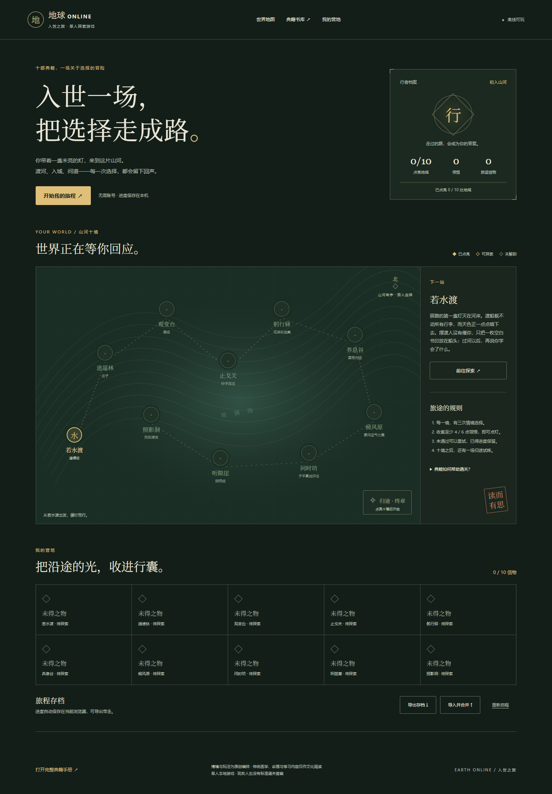

# 地球 Online · 入世之旅

一款可离线玩的中文情境选择游戏，也是一套完整典籍阅读手册。穿过十处地域，在日常处境中做选择、收集信物，随时打开对应原典继续阅读。

[在线游玩](https://39.107.91.13/earth-online/) · [下载完整离线包](https://github.com/erick-huazi/earth-online-game/releases/latest) · [来源与材料说明](THIRD_PARTY.md)



## 游玩与阅读

- 十境与归途终章，共 33 个原创情境、99 个选项；每境三题，达到 4/6 点领悟即可解锁下一境。
- 锦囊、原典入口、十枚信物、重试保留最好成绩、刷新续玩、JSON 存档导入导出。
- 十项书目，2,859 节、1,862,865 字符；支持全文检索、简繁字形匹配、阅读配色、书签、心得和阅读记录备份。
- 纯静态 HTML/CSS/JavaScript，无账号或后端依赖。游戏存档与阅读记录分开保存在浏览器中。

从 Releases 下载 `earth-online-offline-library.zip`，完整解压后打开 `index.html`。请保留 `html/` 和 `books/` 的相对位置。进入 `earth-online-manual.html` 可直接使用典籍手册。

浏览器或网址不同，记录可能分别保存；换设备前请导出存档。原创剧情与评分是游戏设计，不是原典引文。

## 收录书目

| 图片中的书目 | 本项目收录内容 |
| --- | --- |
| 易经 | 周易及相关传文 |
| 道德经 | 81 章 |
| 庄子 | 33 篇 |
| 四柱八字 | 相关原典《子平真诠评注》，图片未指定具体版本 |
| 黄帝内经 | 《素问》《灵枢经》 |
| 五运六气 | 相关原典《素问》运气七篇 |
| 毛选 | 《毛泽东选集》第一至第五卷 |
| 孙子兵法 | 十三篇 |
| 阴符经 | 《黄帝阴符经》上、中、下三章 |
| 炁体源流 | 上下册 512 页的 OCR 与原页图 |

《炁体源流》识别文字未逐字校勘。《毛选》第三卷源 PDF 的第 151–153 页补文说明保留在阅读页。原件、来源、文件校验记录见 [`outputs/books/`](outputs/books/)。

## 本地运行与构建

成品已经包含在 `outputs/`，直接打开即可游玩。也可以在仓库根目录运行：

```sh
python -m http.server 8767 --directory outputs --bind 127.0.0.1
```

访问 `http://127.0.0.1:8767/`。修改源码后，用 Node.js 20 或更新版本重新构建：

```sh
npm run build
```

构建本身只使用 Node 内置模块，不需要安装 npm 依赖；会读取仓库内的书目清单、正文和原页图，重建手册、十本全书页和游戏。打包需要 Python 3：

```sh
python work/package-library.py
```

输出为 `outputs/earth-online-offline-library.zip`。Git 不跟踪压缩包，发布成品放在 Releases。

## 验证

浏览器验收覆盖逐题通关、解锁门槛、重试、刷新续玩、存档合并、异常存储、旧手册记录保护、320/390 像素布局和离线游玩，共 15 项。

```sh
npm install
npx playwright install chromium
npm test
```

如使用已安装的 Chrome，可将环境变量 `PLAYWRIGHT_CHANNEL` 设为 `chrome`。截图和本地测试报告会被 Git 忽略。

## 目录

| 路径 | 内容 |
| --- | --- |
| `outputs/` | 可直接运行的完整网站、书籍原件与来源记录 |
| `work/game-*`、`work/game.css`、`work/game.js` | 游戏模板、剧情、样式与逻辑 |
| `work/build-game.cjs` | 游戏构建入口 |
| `work/build.cjs`、`work/full-book.cjs` | 手册与独立全书页构建入口 |
| `work/download-manifests/`、`work/html-manifests/` | 书目与转换文本清单 |
| `work/qa-earth-game.cjs` | 15 项真实页面验收 |

书籍、扫描件、整理文本和检索字表分别保留其来源及适用权利信息；本仓库没有为所有材料统一授予开源许可。详见 [THIRD_PARTY.md](THIRD_PARTY.md)。
