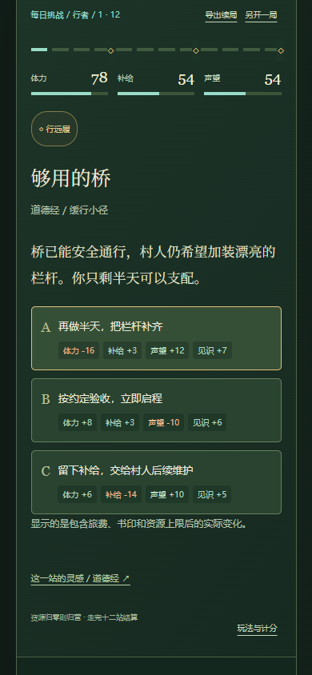

# 地球 Online · 山河远征

一袋行粮，三枚书印，十二站未知山河。选路线、做取舍、组合遗物能力，在同一张地图上走出不同结局。

v2 增加可离线玩的短局策略远征，同时保留原有 33 场故事和完整典籍手册。一次约 3–5 分钟是设计目标，实际时长取决于阅读和选择速度。

[在线游玩](https://39.107.91.13/earth-online/) · [下载完整离线包](https://github.com/erick-huazi/earth-online-game/releases/latest) · [来源与材料说明](THIRD_PARTY.md)


## 一局山河，几种走法

- **12 站旅程**：从 30 个原创事件、90 个选项中生成遭遇。先选路线，再做资源取舍；选项都有代价与收益。
- **3 个角色、10 枚遗物**：开局各有所长，沿途选择书印组合能力，改变应对局面的方式。
- **9 种结局**：不同资源与行动导向不同归途；本机记录最佳旅程分，结局图鉴显示已遇见的归途。
- **每日同图挑战**：北京时间每日零点更新共用种子；也可自由远征。相同种子、角色与选择能复现同一结果。本机记录当日最佳分和连续挑战天数。
- **键盘可玩**：按 1 / 2 / 3 选路线、取舍和书印，回声页按 Enter 继续；会让资源归零的选项有归营提示。
- **朋友接力**：下载 PNG 战报、复制挑战链接或口令；朋友可用相同种子与角色另开一局。分享只含开局配置，不含心得、书签或存档。
- **自动续局与备份**：刷新继续，JSON 导出/导入当前远征。远征、经典剧情和典籍阅读各自保存记录。



成绩保存在本机。玩法与传播效果尚待真实玩家验证。

## 经典剧情与阅读

- 十境与归途终章，共 33 个原创情境、99 个选项；每境三题，达到 4/6 点领悟即可解锁下一境。
- 锦囊、原典入口、十枚信物、重试保留最好成绩、刷新续玩、JSON 存档导入导出。
- 十项书目，2,859 节、1,862,865 字符；支持全文检索、简繁字形匹配、阅读配色、书签、心得和阅读记录备份。
- 纯静态 HTML/CSS/JavaScript，无账号或后端依赖。游戏存档与阅读记录分开保存在浏览器中。

从 Releases 下载 `earth-online-offline-library.zip`，完整解压后打开 `index.html`。请保留 `html/` 和 `books/` 的相对位置。进入 `earth-online-manual.html` 可直接使用典籍手册。

远征存档使用 `earth-online-expedition-v2`，经典剧情仍使用 `earth-online-game-v1`。浏览器或网址不同，记录可能分别保存；换设备前请从相应模式导出存档。远征续局文件只恢复该局，不等于全部本机成就档案。原创事件、剧情与评分是游戏设计，不是原典引文。

## GitHub 项目怎样融入游戏

评分按本轮玩法适配 30、离线 20、维护与稳定 15、许可 15、体积性能适配 10、接入成本 10 计算，属于项目适配判断，星数不计分。完整证据见 [研究报告](outputs/game-research-v2.html) 和 [评分 JSON](outputs/game-research-v2.json)。

| 项目 | 评分 | 本轮采用方式 |
| --- | ---: | --- |
| [seedrandom](https://github.com/davidbau/seedrandom) | 94 | 固定 3.0.5；实际接入确定性生成与严格回放 |
| [lz-string](https://github.com/pieroxy/lz-string) | 92 | 固定 1.5.0；实际接入种子、角色挑战口令 |
| [inkjs](https://github.com/y-lohse/inkjs) | 87 | 参考条件叙事组织，未引入其运行时或故事 |
| [canvas-confetti](https://github.com/catdad/canvas-confetti) | 86 | 固定 1.9.4；实际接入成功结局反馈，尊重减少动态偏好 |
| [A Dark Room](https://github.com/doublespeakgames/adarkroom) | 82 | 参考探索与资源消耗设计，未复制代码或素材 |
| [boardgame.io](https://github.com/boardgameio/boardgame.io) | 75 | 参考行动、状态与回放边界，未引入多人框架 |
| [Phaser](https://github.com/phaserjs/phaser) | 74 | 未来实时玩法候选，本轮未引入 |
| [PixiJS](https://github.com/pixijs/pixijs) | 72 | 未来大规模渲染候选，本轮未引入 |

三份实际采用的运行时代码合计 31,359 字节，构建时内嵌，无运行时 CDN 请求。固定版本、来源与哈希见 [`work/vendor/manifest.json`](work/vendor/manifest.json)，完整 MIT/ISC 许可随离线包保留在 [`outputs/game-third-party-notices.txt`](outputs/game-third-party-notices.txt)。

## 收录书目

| 图片中的书目 | 本项目收录内容 |
| --- | --- |
| 易经 | 周易及相关传文 |
| 道德经 | 81 章 |
| 庄子 | 33 篇 |
| 四柱八字 | 相关原典《子平真诠评注》，图片未指定具体版本 |
| 黄帝内经 | 《素问》《灵枢经》 |
| 五运六气 | 相关原典《素问》运气七篇 |
| 毛选 | 《毛泽东选集》第一至第五卷 |
| 孙子兵法 | 十三篇 |
| 阴符经 | 《黄帝阴符经》上、中、下三章 |
| 炁体源流 | 上下册 512 页的 OCR 与原页图 |

《炁体源流》识别文字未逐字校勘。《毛选》第三卷源 PDF 的第 151–153 页补文说明保留在阅读页。原件、来源、文件校验记录见 [`outputs/books/`](outputs/books/)。

## 本地运行与构建

成品已经包含在 `outputs/`，直接打开即可游玩。也可以在仓库根目录运行：

```sh
python -m http.server 8767 --directory outputs --bind 127.0.0.1
```

访问 `http://127.0.0.1:8767/`。修改源码后，用 Node.js 20 或更新版本重新构建：

```sh
npm run build
```

构建脚本只使用 Node 内置模块，不需要安装 npm 依赖；会读取本地第三方库、原创剧情与规则、书目清单、正文和原页图，重建手册、十本全书页和游戏。第三方库固定文件已包含在仓库中。

如需重建项目评分报告，运行 `python work/build-game-research-v2.py`；该脚本读取已保存的核查证据，不自动联网刷新评分。完整打包需要 Python 3：

```sh
python work/package-library.py
```

输出为 `outputs/earth-online-offline-library.zip`。Git 不跟踪压缩包，发布成品放在 Releases。

## 验证

测试分为三组：经典剧情 15 项页面验收、远征引擎 15 项规则验收，以及远征浏览器流程 23 项验收。覆盖确定性生成、行动回放、资源与遗物、续局导入、挑战码、PNG 下载、旧记录保护、移动布局和离线游玩；这些检查不等同于真实玩家留存实验。

```sh
npm install
npx playwright install chromium
npm test
```

只检查远征规则可运行 `npm run test:engine`，无需启动浏览器。GitHub Actions 在每次推送和合并请求时运行这组规则验收，并确认 `outputs/` 里的游戏页与源码重新构建的结果一致；浏览器流程验收仍在本机运行。

版本变化见 [CHANGELOG.md](CHANGELOG.md)。

如使用已安装的 Chrome，可将环境变量 `PLAYWRIGHT_CHANNEL` 设为 `chrome`。截图和本地测试报告会被 Git 忽略。

## 目录

| 路径 | 内容 |
| --- | --- |
| `outputs/` | 可直接运行的完整网站、书籍原件与来源记录 |
| `work/game-*`、`work/game.css`、`work/game.js` | 游戏模板、剧情、样式与逻辑 |
| `work/expedition-*`、`work/expedition.css` | 山河远征内容、规则、界面与样式 |
| `work/vendor/` | 三个固定版本依赖、完整许可与哈希清单 |
| `work/build-game.cjs` | 游戏构建入口 |
| `work/build.cjs`、`work/full-book.cjs` | 手册与独立全书页构建入口 |
| `work/download-manifests/`、`work/html-manifests/` | 书目与转换文本清单 |
| `work/qa-earth-game.cjs` | 15 项真实页面验收 |
| `work/qa-expedition-engine.cjs`、`work/qa-expedition-browser.cjs` | 远征规则与页面流程验收 |
| `work/build-game-research-v2.py`、`work/game-upstream-meta.json` | 项目评分报告生成与核查证据 |

书籍、扫描件、整理文本和检索字表分别保留其来源及适用权利信息；本仓库没有为所有材料统一授予开源许可。详见 [THIRD_PARTY.md](THIRD_PARTY.md)。
